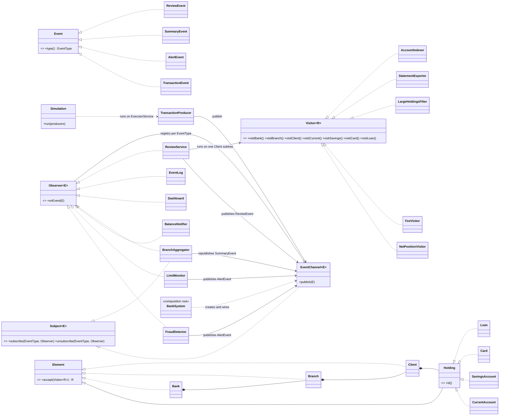

# Bank Transactions: Observer + Visitor (Assignment 6, variant 11)

Java 17, JUnit 5, no other libraries. A transaction stream feeds listeners (fraud detector, balance notifier,
limit monitor, audit log, branch aggregator, dashboard); a Composite tree (Bank → Branch → Client → accounts,
cards, loans) is processed by visitors (net position, fees, large holdings filter, JSON statement export).
An alert triggers a visitor run on the affected client's subtree only, and the report returns as a new event.

## Run

```
mvn test                         # 28+ JUnit 5 tests
mvn -q compile && java -cp target/classes Main [threads]
```

## Structure (flat package on purpose: one short file per class)

| Part | Classes |
| --- | --- |
| Events (immutable records) | `TransactionEvent`, `AlertEvent`, `SummaryEvent`, `ReviewEvent`, `EventType` |
| Observer infrastructure | `Observer<E>`, `Subject<E>`, `EventChannel<E>`, `EventLog<E>` |
| Listeners | `FraudDetector`, `LimitMonitor`, `BalanceNotifier`, `BranchAggregator` (also a Subject), `Dashboard`, `EventLog` (audit), `ReviewService` |
| Composite tree (data only) | `Bank`, `Branch` (containers), `Client` (container), `CurrentAccount`, `SavingsAccount`, `Card`, `Loan` (leaves) |
| Visitors | `NetPositionVisitor` (numeric), `FeeVisitor` (accumulates state), `LargeHoldingsFilter` (returns a list), `StatementExporter` (JSON), `AccountIndexer` (start-up index) |
| Concurrency | `TransactionProducer`, `Simulation` |
| Composition root | `BankSystem` (the only place with `new` for listeners and channels), `Main`, `SampleBank` |

## UML



## Design decisions

**Observer: push, not pull.** An event carries all the data a listener needs (account, amount, type, source). With
pull, listeners would read the source's state while several producer threads change it, and would need locks to see a
consistent value. A push event is an immutable snapshot, so any number of listeners on any thread read it safely.
The cost is that every event is allocated even if nobody wants its fields.

**Registry.** `EventChannel` keeps a `ConcurrentHashMap<EventType, CopyOnWriteArrayList<Observer>>`. `publish`
iterates a snapshot, so observers can subscribe or unsubscribe at any time, including inside their own handler or from
another thread, and no lock covers the whole subject. Writes are slow (array copy), reads are fast: right for a
registry that changes rarely and is read for every event. `addIfAbsent` makes subscribing twice harmless.

**Two sources, one class.** The ATM and online-banking streams are two `EventChannel` instances. They differ only in
data, not behaviour, so a second class would have no reason to exist.

**Chain of observers.** `BranchAggregator` is an `Observer<TransactionEvent>` and a `Subject<SummaryEvent>`; `Dashboard`
listens to it. Summaries from different threads can arrive out of order, so `Dashboard` keeps the one with the larger
transaction count.

**Delivery is synchronous.** The publishing thread runs the handlers. When `Simulation.run` returns, every event has
been completely processed, which is what makes "no lost events" provable with exact counts. Handlers must be short;
a slow listener slows its producer (an async queue per listener would be the next step).

**Visitor: the visitor does the traversal.** Each visitor combines child results differently (sum, list, JSON string,
mutable state) and `ReviewService` starts a visitor at a single `Client`. If the tree did the traversal, it would need a
generic fold API that every new kind of visitor stretches. Cost: each visitor repeats three small loops. Elements are
records with only `accept`.

**Integration.** `ReviewService` listens to `FRAUD_ALERT` and `LIMIT_BREACH`, finds the client of the account, runs
`NetPositionVisitor` and `StatementExporter` on that `Client` only, and publishes `CLIENT_REVIEW`. The test checks that
only that client's data is in the result. Both visitors are stateless, so one instance is shared by all threads;
stateful visitors (`FeeVisitor`, `AccountIndexer`) are created per run.

**Concurrency (ch. 13).** `Simulation` runs producers on a fixed pool of configurable size, calls `shutdown()`,
waits with a timeout, then calls `get()` on every future so a failed producer is reported. `shutdownNow()` in `finally`
stops stragglers. Shared state uses `ConcurrentHashMap.merge` (atomic update and the new value in one step),
`ConcurrentLinkedQueue` and `ConcurrentHashMap.newKeySet().add` (exactly one thread wins the limit-breach alert).

**Clean Code (ch. 11–12).** `BankSystem` is the only composition root; all dependencies are constructor parameters;
no lazy initialization; money is `long` cents formatted as decimals only for output.

## Trade-off proof (two separate commits)

| Commit | Files changed | Lines |
| --- | --- | --- |
| `Add InterestVisitor (new operation, no element class changed)` | `InterestVisitor.java` (new), `InterestVisitorTest.java` (new) | +54 |
| `Add Deposit element (new element type)` | `Deposit.java` (new); `Visitor.java`; `NetPositionVisitor.java`, `FeeVisitor.java`, `LargeHoldingsFilter.java`, `StatementExporter.java`, `AccountIndexer.java`, `InterestVisitor.java`; `DepositTest.java` (new); `VisitorTest.java` | +61, 10 files |

A new operation costs one new file and touches no existing class: this is the strength of Visitor. A new element type
costs one new method in the `Visitor` interface and one method in **every** visitor (6 here), and the compiler forces
all of them. The cost grows with the number of visitors. I would reject Visitor if new product types appeared more often
than new operations; then plain polymorphic methods on the elements are cheaper.

## Tests

31 JUnit 5 tests after both commits (28 before):
`EventChannelTest` (type filtering, unsubscribe, self-unsubscribe in handler, subscribe in handler, duplicates, validation, money format),
`ListenerTest` (each listener, the chain, out-of-order summaries), `VisitorTest` (hand-calculated values, double dispatch, JSON, subtree),
`SystemTest` (alert → review on one subtree, stress test 4 threads × 1,000 events with exact totals, join/leave under load,
failing producer, timeout, graceful shutdown), `InterestVisitorTest`, `DepositTest`.

Stress test arithmetic: one producer sends 1,000 events of 1.00 in the cycle deposit, withdrawal, payment: 334 deposits and
666 outgoing, so net = (334 − 666) × 1.00 = −332.00. Four producers: −1328.00. Opening balance 1000.00 gives −328.00 and
the dashboard must show 4,000 transactions with net −1328.00.
